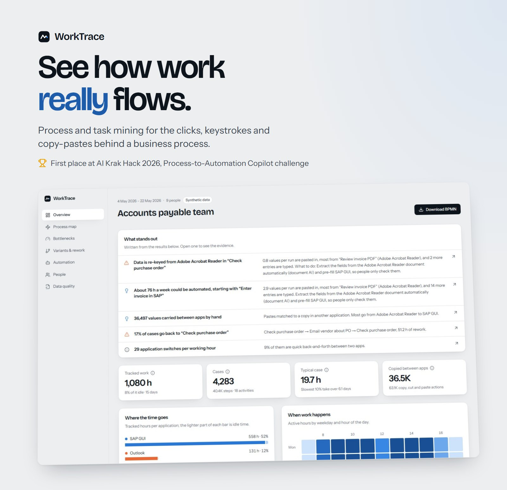
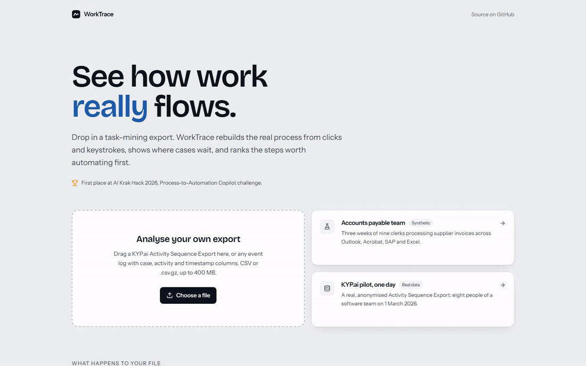
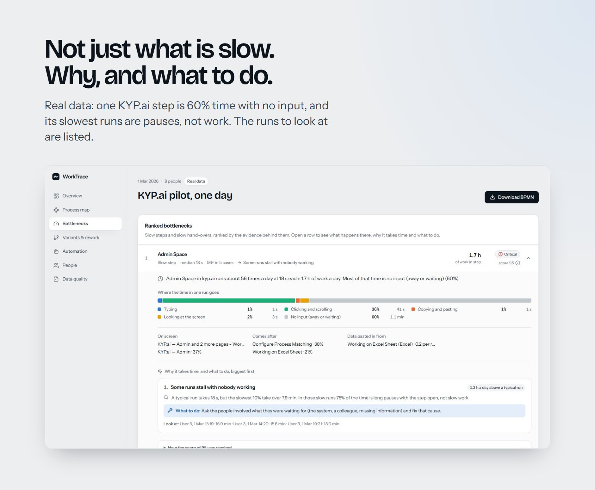
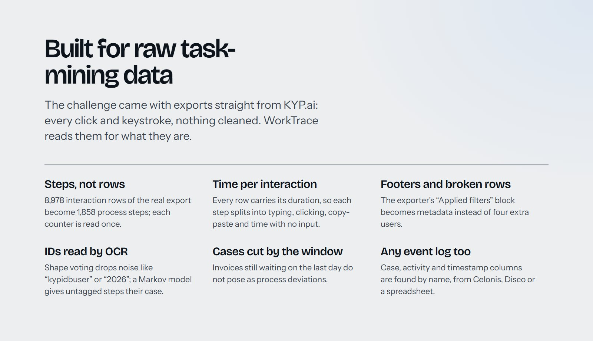
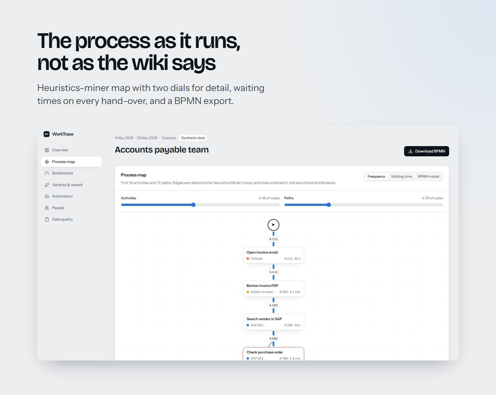
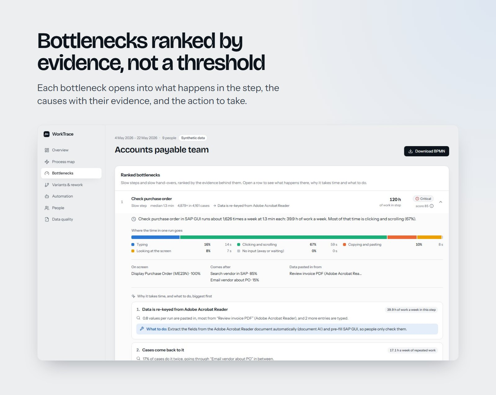
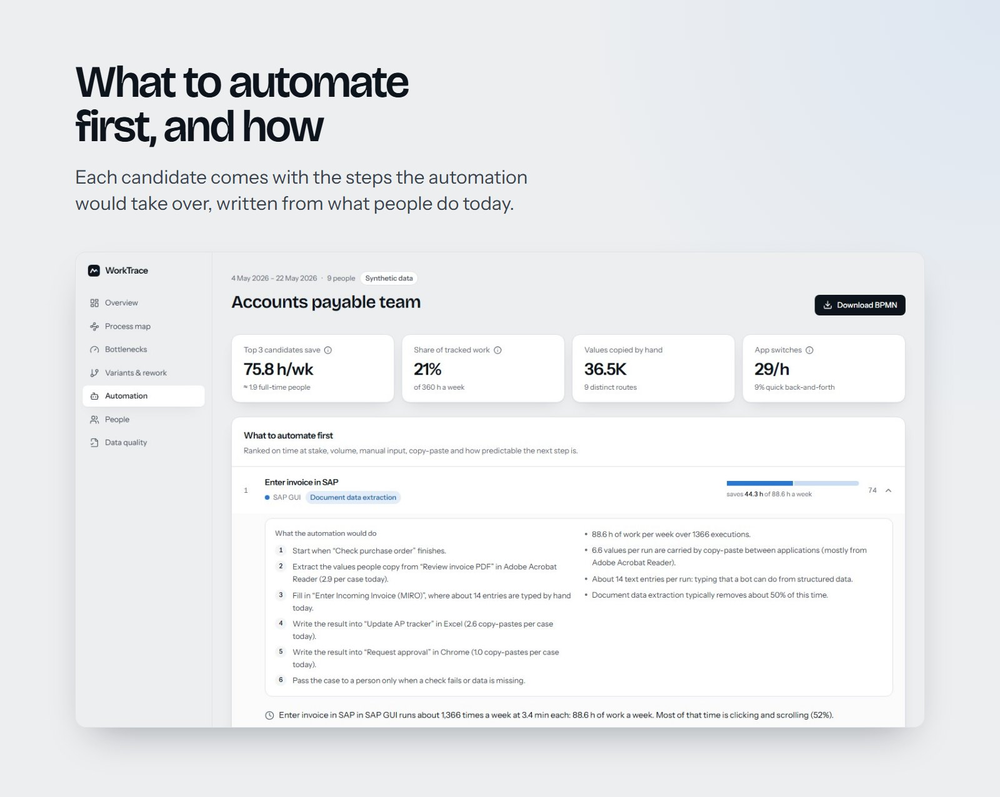
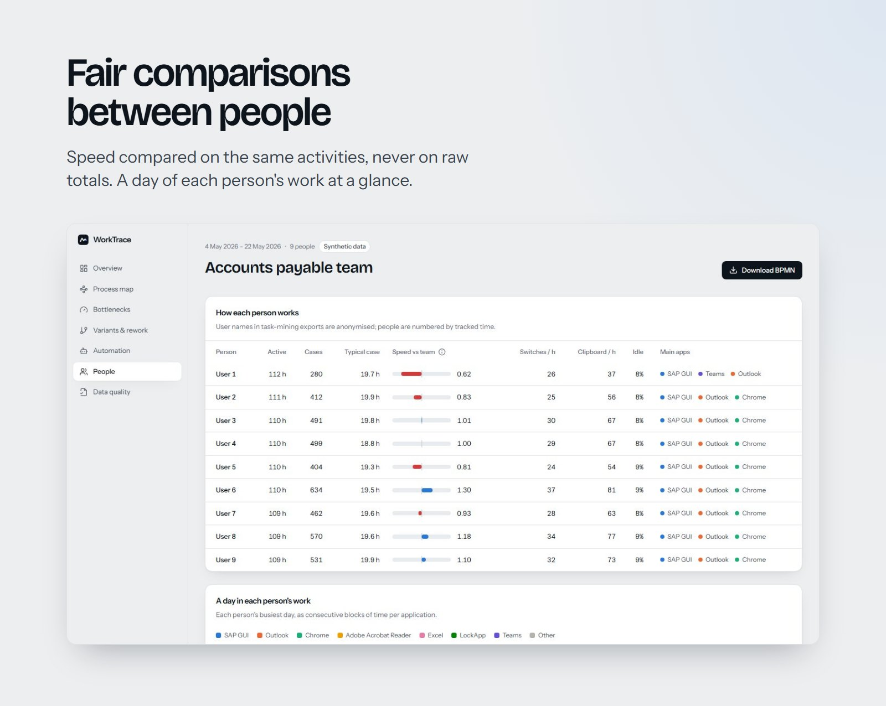
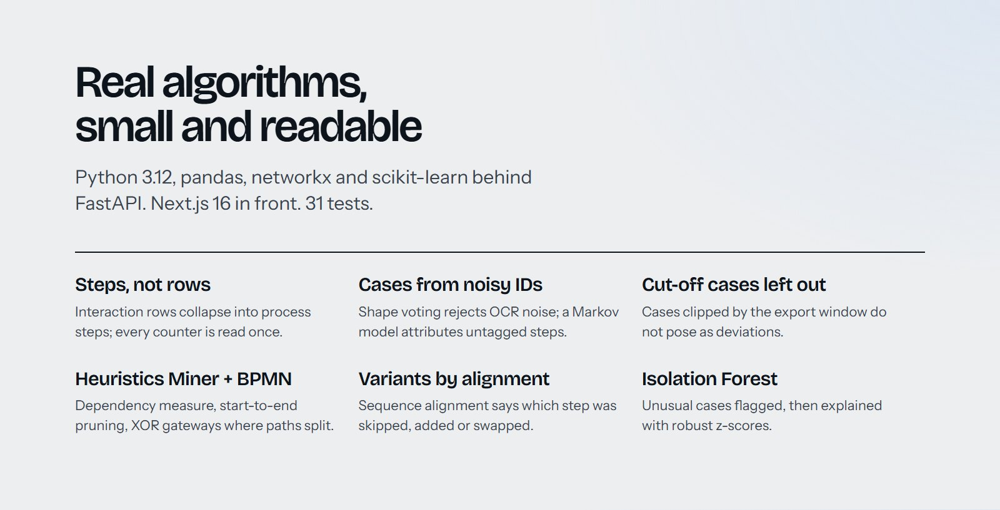
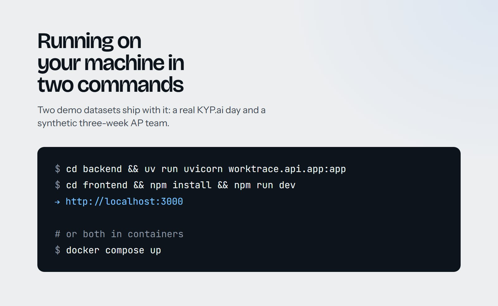

<p align="center"></p>

<p align="center"></p>

<p align="center"></p>

<p align="center"></p>

<p align="center"></p>

<p align="center"></p>

<p align="center"></p>

<p align="center"></p>

<p align="center"></p>

<p align="center"></p>

<p align="center">
  <a href="docs/ENGINEERING.md"><b>How it works</b></a>&nbsp;&nbsp;|&nbsp;&nbsp;<a href="#run-it"><b>Run it</b></a>&nbsp;&nbsp;|&nbsp;&nbsp;<a href="docs/challenge-brief.pdf"><b>The challenge</b></a>
</p>

<p align="center">
  
  
  
  
</p>

## About

WorkTrace is team VibeCoders' winning entry to the **Process-to-Automation Copilot** challenge at **AI Krak Hack 2026** (Kraków, 27–28 March 2026). The brief: take raw task-mining data from KYP.ai (every click, keystroke and copy-paste of a team at work), reconstruct how the process really runs, find the bottlenecks and say what to automate.

The point is the last part. A dashboard that says “Excel is a bottleneck” helps nobody. WorkTrace opens every bottleneck into what happens in that step: how its time splits into typing, clicking, copy-paste and time with nobody working, which screens it happens in, where the data comes from and goes, and which people and runs stand out. From that it says why the step is slow and what to do about it, with the hours each fix concerns and the runs to look at.

## What it does

- **Reads messy exports.** KYP.ai Activity Sequence Exports (plain or `.gz`, any common encoding) and generic event logs with case, activity and timestamp columns. Footers, broken rows and repeated counters are handled; the Data quality tab says what was fixed.
- **Finds the cases.** Business IDs read by OCR are cleaned by shape voting, and untagged steps are attributed to cases with a Markov model of the process. Without usable IDs, work is split into sessions.
- **Maps the process.** Heuristics Miner dependency graph with Disco-style sliders for activities and paths, waiting times on every hand-over, and a BPMN 2.0 export.
- **Explains every bottleneck.** The time inside a step split by what the person was doing, the slow runs and what they are made of, re-keyed data, look-ups in other apps, people who take twice as long, approval queues and overnight waits: each as a cause with its evidence and a concrete action.
- **Says what to automate and how.** Candidates scored on time, volume, manual input, copy-paste and predictability, each with the steps the automation would take over. Optional Gemini explanations, grounded in the measured numbers only.
- **Compares people fairly** (speed on the same activities, not raw totals), finds rework loops, routines, copy-paste flows between applications and unusual cases.

<details>
<summary><b>Run it</b></summary>

<br>

Python 3.12+ with [uv](https://docs.astral.sh/uv/), and Node.js 22+.

```bash
cd backend && uv run uvicorn worktrace.api.app:app     # API on :8000
cd frontend && npm install && npm run dev              # dashboard on :3000
```

Open http://localhost:3000 and pick a demo dataset, or upload your own export. Or run both in containers with `docker compose up`.

```bash
cd backend && uv run pytest                             # 31 tests, including ground-truth checks on synthetic data
uv run python -m worktrace.synthetic --days 15          # regenerate the synthetic AP team
GEMINI_API_KEY=... uv run uvicorn worktrace.api.app:app  # turn on Gemini explanations
```

</details>

<details>
<summary><b>The data</b></summary>

<br>

| Dataset | What it is |
| --- | --- |
| `data/demo/kyp_pilot_day.csv.gz` | A real, anonymised KYP.ai Activity Sequence Export from the hackathon: eight people of a software team on 1 March 2026. Screen text, OCR and URLs are removed; window titles are kept with hosts and addresses masked. |
| `data/demo/accounts_payable.csv.gz` | Synthetic: three weeks of nine accounts-payable clerks, written by [`synthetic.py`](backend/worktrace/synthetic.py) in the exact export format with its quirks (repeated counters, NOT_FOUND and junk IDs, the footer). Built-in behaviour (approval waits, an 18% missing-PO loop, a slower clerk) is checked by the tests. |

The full challenge dataset (1.6 GB) belongs to the organisers and is not included.

</details>

<details>
<summary><b>Credits</b></summary>

<br>

Built by team VibeCoders at AI Krak Hack 2026: Mateusz Caputa, Marcin Pałys and Kacper Smaga.

</details>
